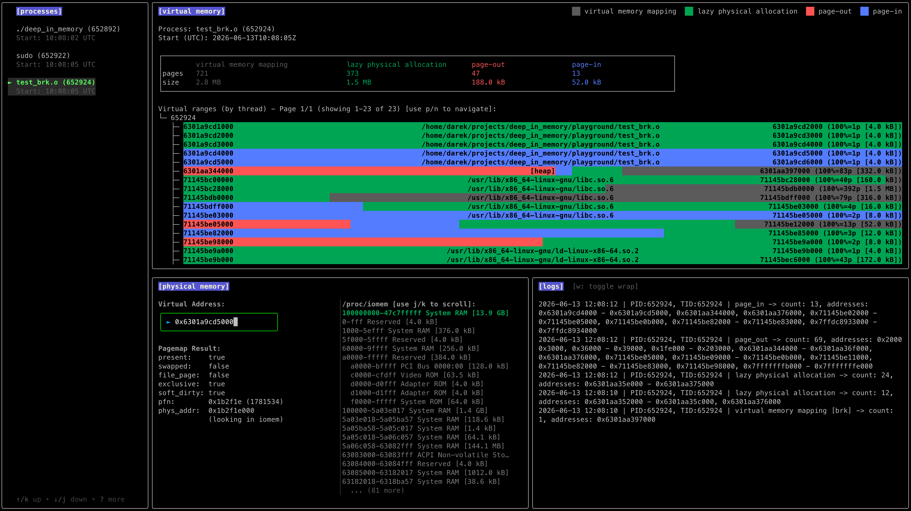

# deep_in_memory

A Linux terminal UI for real-time tracing and visualization of memory operations — `brk`, `mmap` / `munmap`, page faults, and swap — for a selected process.

Built with eBPF for zero-overhead kernel tracing and a Bubble Tea TUI for interactive exploration.

---

## What it does

`deep_in_memory` attaches eBPF probes to key kernel functions and syscalls, captures every memory event for a target process, and presents the data in a live terminal dashboard:

- **Virtual memory panel** — every `mmap`/`munmap` and `brk` range, paginated, with per-range status bars showing reservation vs. allocation vs. swap
- **Physical memory panel** — look up any virtual address to get its page frame number (PFN) and cross-reference it against `/proc/iomem` hardware ranges
- **Log panel** — aggregated event stream with counts and address ranges per event type

---

## Preview




---

## Traced events

| Kernel hook | Event type | What it captures |
|-------------|-----------|-----------------|
| `sched_process_exec` tracepoint | `ProcessExec` | New process started |
| `sched_process_exit` tracepoint | `ProcessExit` | Process exited |
| `sys_enter/exit_mmap` tracepoints | `ProcessMmap` | `mmap` syscall completed — new virtual range |
| `sys_enter/exit_munmap` tracepoints | `ProcessMunmap` | `munmap` syscall — range freed |
| `sys_enter/exit_brk` tracepoints | `ProcessBrk` | `brk` syscall — heap grow/shrink |
| `do_anonymous_page` kprobe | `INIT` status | Page lazily allocated (first write fault) |
| `swap_writepage` kprobe | `SWAP` status | Page evicted to swap |
| `do_swap_page` kprobe | `UNSWAP` status | Page read back from swap |

---

## Requirements

| Requirement | Details |
|-------------|---------|
| OS | Linux only |
| Kernel | ≥ 5.8 with BTF support (`/sys/kernel/btf/vmlinux` must exist) |
| Privileges | `CAP_BPF` + `CAP_PERFMON`, or `root` |
| Architecture | `amd64` |

---

## Installation

### From source (host build)

```bash
# Build dependencies (Debian/Ubuntu)
apt-get install -y bpftool clang llvm libbpf-dev

# Clone and build
git clone https://github.com/your-org/deep_in_memory
cd deep_in_memory

make prepare   # generates vmlinux.h from running kernel
make generate  # generates eBPF Go bindings
make build     # produces ./deep_in_memory binary
```

### Docker

```bash
docker build -t deep_in_memory .
```

The multi-stage Dockerfile handles all build dependencies automatically and produces a minimal
`distroless/static-debian12` image. The container still requires `--privileged` (or `CAP_BPF` +
`CAP_PERFMON`) and `/sys/kernel/btf/vmlinux` bind-mounted from the host at runtime.

---

## Usage

```bash
# Run (requires root or CAP_BPF + CAP_PERFMON)
sudo ./deep_in_memory

# Enable pprof profiling on port 8080
DEBUG=true sudo ./deep_in_memory
```

Files created in the working directory:

| File | Contents |
|------|---------|
| `deep_in_memory.log` | Application log (errors, warnings) |
| `deep_in_memory.db` | Process/range state (deleted on startup) |
| `deep_in_memory_addresses.db` | Per-page offset detail (deleted on startup) |

### Keyboard shortcuts

| Key | Action |
|-----|--------|
| `↑` / `↓` | Navigate process list |
| `Enter` | Select process and start tracing |
| `n` / `p` | Next / previous page of virtual memory ranges |
| `Tab` | Focus physical memory address input |
| `Enter` (in input) | Look up page frame number for address |
| `↑` / `↓` (in input) | Navigate address suggestions |
| `w` | Toggle word-wrap in logs panel |
| `q` / `Ctrl+C` | Quit |

---

## Architecture

```
eBPF collectors (sched / mmap / brk / paging)
        │  emit TimestampedEvent
        ▼
CentralEventCollector      ← batches events, sorts by timestamp
        │
        ▼
app.Model  (Bubble Tea)    ← routes events
        │
        ▼
AsyncDBWriter              ← single goroutine, all BoltDB writes
        │
        ├──► deep_in_memory.db          (ProcessData — ranges + counts)
        └──► deep_in_memory_addresses.db (AddressData — per-page offsets)
                │
        periodic reload → data.BuildDataset → TUI refresh
```

Events from multiple collectors are interleaved in real time. `CentralEventCollector` buffers them and
flushes sorted batches to the Bubble Tea program, ensuring `do_anonymous_page` events are always processed
after their parent `mmap` event regardless of which goroutine wins the race.

---

## Tech stack

| Component | Library |
|-----------|---------|
| eBPF | [cilium/ebpf](https://github.com/cilium/ebpf) |
| TUI framework | [charm.land/bubbletea/v2](https://charm.land/bubbletea/v2) |
| TUI components | [charm.land/bubbles/v2](https://charm.land/bubbles/v2) |
| TUI styling | [charm.land/lipgloss/v2](https://charm.land/lipgloss/v2) |
| Embedded DB | [bbolt](https://github.com/etcd-io/bbolt) + [bolthold](https://github.com/timshannon/bolthold) |
| Serialization | [msgpack v5](https://github.com/vmihailenco/msgpack) |
| Language | Go 1.26.4 |

---

## Development

```bash
make fmt       # go fmt ./...
make test      # full test suite with coverage
make build     # binary (requires Linux with BTF)
```

Tests run without eBPF or root privileges — stub files provide no-op collectors for the test build:

```bash
go test ./...   # no -tags ebpf needed
```

See [AGENTS.md](AGENTS.md) for full developer and agent documentation.

---

## License

See [LICENSE](LICENSE).
